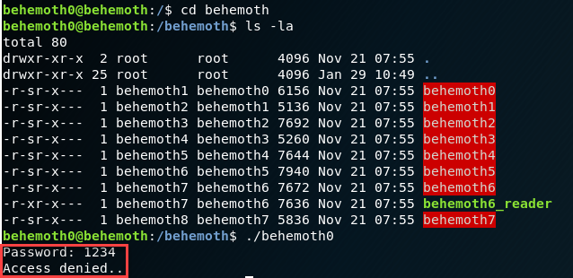
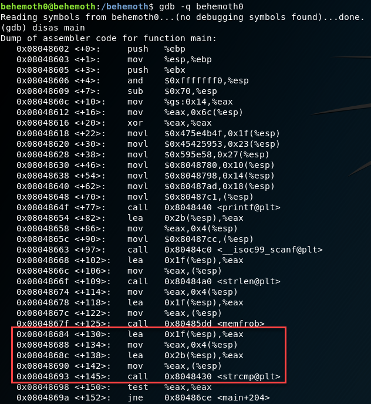
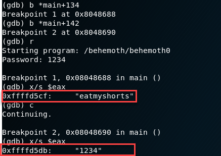
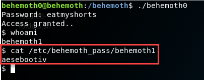

<pre><h3><b>Level 0
Username : behemoth0
Password : behemoth0
SSH      : behemoth.labs.overthewire.org:2221</b></h3></pre>
### Solution

To solve this level, we first log into the behemoth server using the credentials provided above.
As we can see below, the executable for this level, accepts a password as an input. I got an ‘Access Denied..’ message on providing password ‘1234’.

Let’s examine this executable in gdb to see what we can learn about the program.

As we can see, the executable pushes two values on the stack and then makes a call to the strcmp function. If we put break points before the strcmp function, we should be able to see what values are being compared.

As we can see, user’s input (1234 in this case) is being compared against “eatmyshorts”. Therefore, if we use this value, we might gain access to the password for the next round.

<pre><h3><b>Level 1
Username : behemoth1
Password : aesebootiv
SSH      : behemoth.labs.overthewire.org:2221</b></h3></pre>
