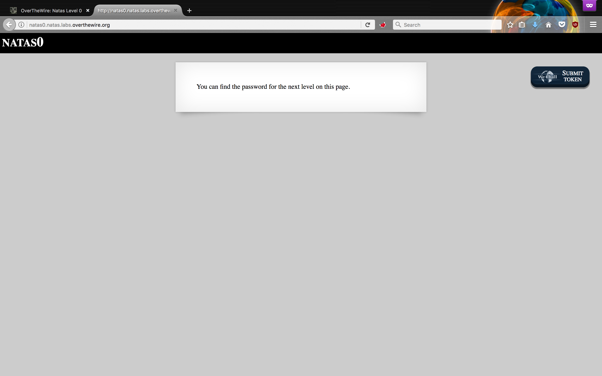
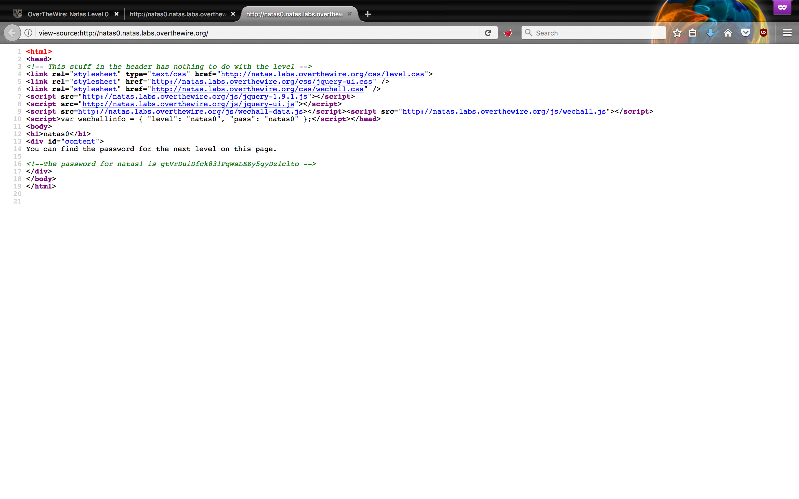

<pre><h3><b>Level 0
Username : natas0
Password : natas0
URL      : http://natas0.natas.labs.overthewire.org</b></h3></pre>
### Solution

To solve this level, we first log into the natas0 application using the credentials provided above.

After logging in, we can see the hint provided by the page 'You can find the password for the next level on this page.‘

As the password is not visible on the page, we view the page source to see if there’s anything more that we can learn about the application from the page.

We can see that the password for natas1 is provided in a comment on the page.

<pre><h3><b>Level 1
Username : natas1
Password : gtVrDuiDfck831PqWsLEZy5gyDz1clto
URL      : http://natas1.natas.labs.overthewire.org</b></h3></pre>
