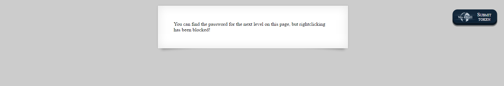
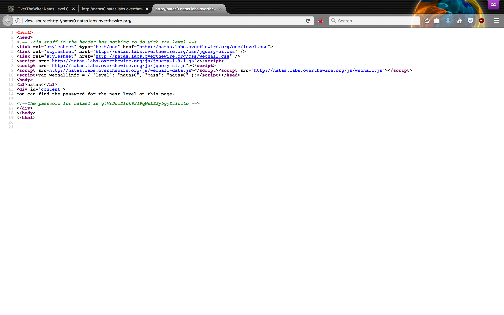
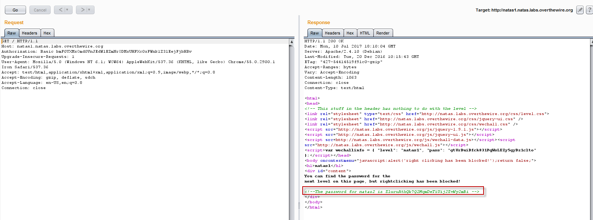

<pre><h3><b>Level 1
Username : natas1
Password : gtVrDuiDfck831PqWsLEZy5gyDz1clto
URL      : http://natas1.natas.labs.overthewire.org</b></h3></pre>
### Solution

To solve this level, we first log into the natas1 application using the credentials provided above.

After logging in, we can see the hint provided by the page ‘**You can find the password for the next level on this page, but rightclicking has been blocked!**‘

A web application can disable the use of right-click using javascript. In this particular case, however, right-clicking is possible on most parts of the page. There are several possible ways to read the HTML content of the page. I’m going to demonstrate using 2 different ways in this blog post.
- Using Inspector
- Using a Proxy

### Using Inspector

We can open Inspector by right clicking on the body of the page where right-click is not disabled and read the HTML of the page.

We can see that the HTML of the page contains the password for natas2 in a comment.

### Using Burp as Proxy
If an application is proxied, we can view all the content transferred from the web server to our browser. This gives us the opportunity to read any data that is delivered to the browser. Using that, we can simply read the response provided by the server to our request for the webpage.

<pre><h3><b>Level 2
Username : natas2
Password : ZluruAthQk7Q2MqmDeTiUij2ZvWy2mBi
URL      : http://natas2.natas.labs.overthewire.org</b></h3></pre>
