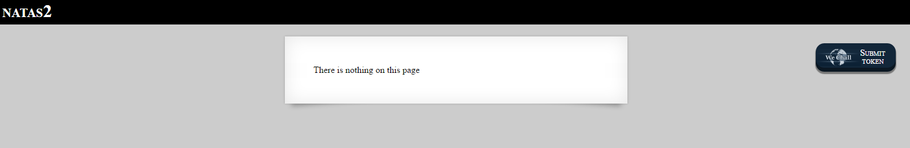
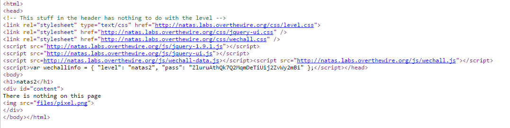
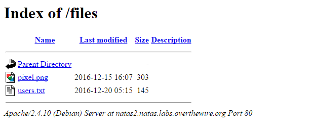
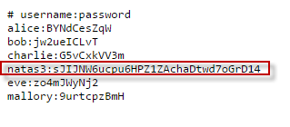

<pre><h3><b>Level 2
Username : natas2
Password : ZluruAthQk7Q2MqmDeTiUij2ZvWy2mBi
URL      : http://natas2.natas.labs.overthewire.org</b></h3></pre>
### Solution

To solve this level, we first log into the natas2 application using the credentials provided above.

After logging in, we can see the message ‘**There is nothing on this page**‘. We start our investigation by reading the HTML content of the page.

As we can see in the image below, there is an image named ‘**pixel.png**’ which can be found by using the relative path ‘**files/pixel.png**‘. This gives us the information that the web application has a folder named ‘**files**’ which stores this image and possibly other files too.

We now navigate to the URL **http://natas2.natas.labs.overthewire.org/files** and we find that there is another file named ‘users.txt‘. We open the file and Voila!, we can see the password for natas3 stored along with other users.

<pre><h3><b>Level 3
Username : natas3
Password : sJIJNW6ucpu6HPZ1ZAchaDtwd7oGrD14
URL      : http://natas3.natas.labs.overthewire.org</b></h3></pre>
